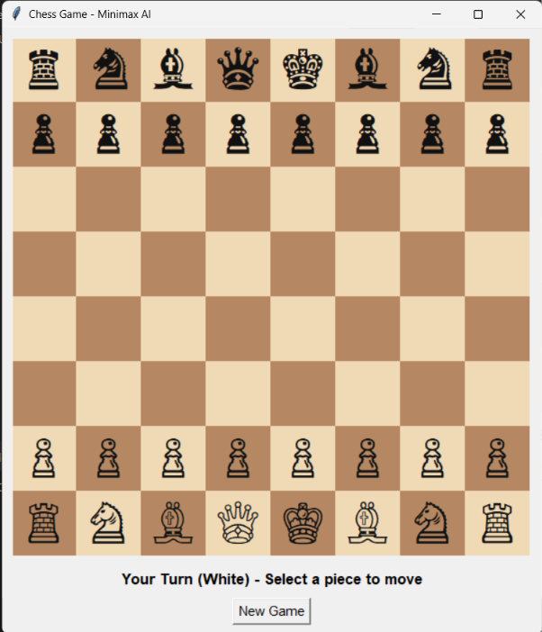

# Chess-Game-Using-Minimax
A Python Chess Game featuring a graphical interface and an AI opponent powered by the Minimax Algorithm with Alpha-Beta Pruning.
## Features

- Player vs Computer gameplay.
- AI opponent powered by the Minimax algorithm.
- Intelligent move selection.
- Interactive chess game.
- 
 ## Technologies Used
- Python
- Tkinter (GUI)
- python-chess Library
- Minimax Algorithm
- Alpha-Beta Pruning
## How to Run

1. Clone the repository.
2. Install the required dependencies:

   pip install -r requirements.txt

3. Run the game:

   python chess_minimax.py
## Algorithm

The computer uses the Minimax algorithm to evaluate possible moves and choose the best move against the human player.
## Screenshot

